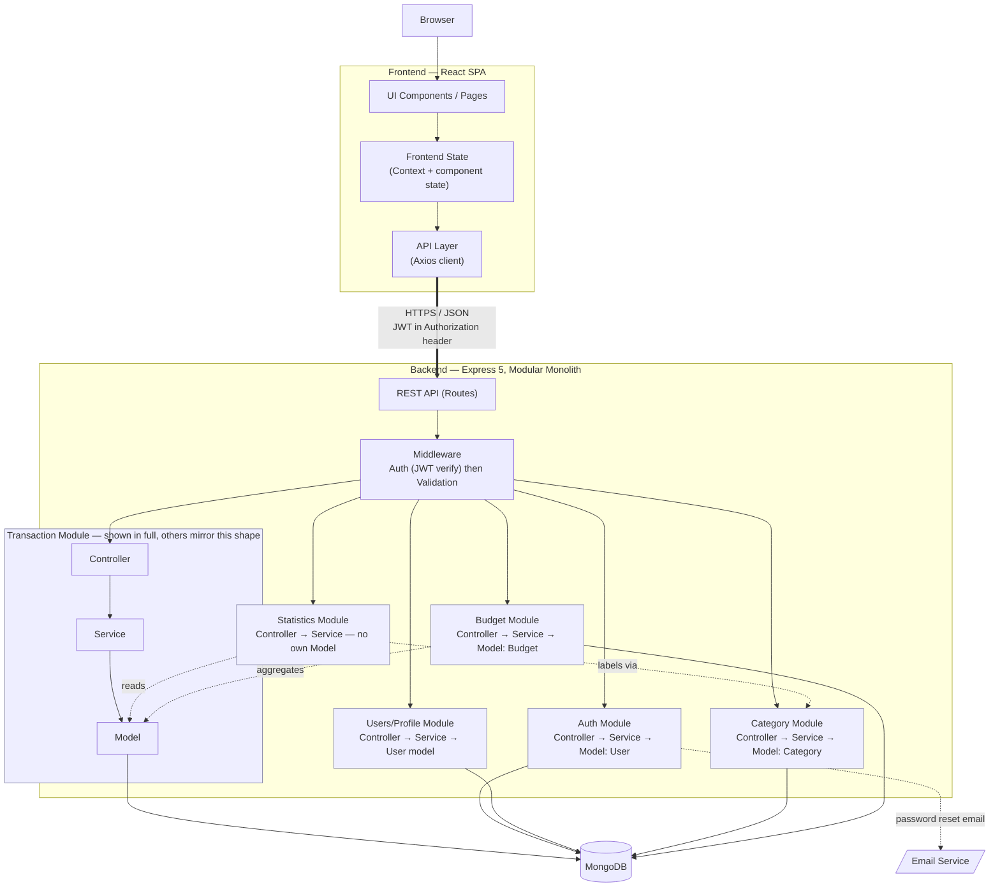

# Personal Expense Manager — Software Architecture

| | |
|---|---|
| **Document status** | ARCHITECTURE BASELINE v1.5 — implementation reconciliation and bilingual UI note added 2026-10-11; see Amendment Log |
| **Date** | Original baseline: 2026-08-31 · Last reconciliation: 2026-10-11 |
| **Builds on** | requirements-baseline-v1.0.md, use-case-model-v1.0.md |
| **Constraints** | Solo student dev · React · Node/Express · MongoDB · JWT · REST · modular monolith · easy local dev/deploy/test · clear separation of concerns |
| **Layering principle (target architecture)** | `UI → Frontend State/API Layer → REST API → Controller → Service → Model/Database` — no layer added beyond this |

---

> **Implementation reconciliation (2026-10-11):** This is the original architecture baseline, not a claim that every proposed structure was implemented verbatim. The shipped repository uses `frontend/` and `backend/`; the frontend API layer uses Axios in `frontend/src/services/axiosClient.js`; the backend also contains a Users/Profile module. Budget and Statistics currently execute read-only aggregates through Mongoose models directly rather than routing every read through the Transaction service. Treat those items as documented implementation deviations from the original design, not as implemented abstractions. The verified structure and current behavior in source code take precedence over illustrative trees below. The current frontend also uses a dependency-free `LanguageProvider`/`LanguageContext` with an English/Vietnamese dictionary and browser-local preference; this is presentation state only and does not alter API contracts or stored financial data.

## 1. High-Level Architecture

Three tiers, one deployable backend, no microservices:

```
[ Browser ]
     |  HTTPS
[ React SPA — static build ]
     |  REST/JSON, JWT in Authorization header
[ Express API — single Node.js process, modular monolith ]
     |  Mongoose
[ MongoDB — single database, 4 collections ]
```

- **Client tier:** React SPA, built as static assets, served independently of the API (e.g. Vercel/Netlify).
- **Server tier:** one Express application, one deployable unit (e.g. Render/Railway), internally split into feature modules — this is what "modular monolith" means here: module boundaries in code, not in deployment.
- **Data tier:** one MongoDB database (self-hosted or Atlas), no per-module database splitting.
- **Auth is stateless (JWT):** no session store, no Redis, no sticky sessions — one less moving part for a solo deploy.

## 2. Component Architecture

Six application modules, each using routes/controllers/services where applicable (models may be shared, e.g. User is defined in Auth):

| Module | Owns | Depends on |
|---|---|---|
| **Auth** | Registration, login, password reset and User model | *(foundation module)* |
| **Users / Profile** | Read/update own profile | Auth |
| **Category** | Default + custom categories | Auth |
| **Transaction** | Income/expense records | Auth, Category |
| **Budget** | Spending limits | Auth, Category, Transaction (reads, to compute status) |
| **Statistics** | Aggregated reports | Auth, Transaction, Category (reads only, owns no data) |

Dependencies flow primarily one direction — **Auth → {Users/Profile, Category} → Transaction → {Budget, Statistics}** — with no intended cycles. This is deliberate: a module with no incoming dependency from "above" can be reasoned about, tested, and (per NFR-05) hypothetically extracted later without touching its dependents. Budget and Statistics are read-only consumers of Transaction data. In the current source they use Mongoose aggregation queries directly for derived spending/statistics; they do not write Transaction documents. This is an implementation choice that reduces extra service calls for aggregation, and should be reconsidered only with regression coverage.

## 3. Frontend Architecture

- **Scaffold:** Vite + React (not Create React App — unmaintained; Vite is the current standard for new React SPAs).
- **Routing:** React Router. A `ProtectedRoute` wrapper checks auth state and redirects to Login if absent, gating every route except Login/Register/Forgot-Password.
- **State — two kinds, kept separate:**
  - *Global client state* (who's logged in, the JWT): one `AuthContext` via React's built-in Context API. This is the only global state the app needs — a full store (Redux/Zustand) would be unjustified complexity for one piece of shared state.
  - *Server state* (transactions, categories, budgets, stats): fetched per-page into local component state via the API layer below. No client-side cache/store layer in MVP — traffic and data volume for a single user don't warrant one. *(Optional upgrade path: TanStack Query, if manual `useEffect`/loading-state boilerplate becomes painful — not required for MVP.)*
- **API layer** (the "Frontend State / API Layer" step in your principle): one function per resource (`transactionApi.js`, `categoryApi.js`, …), all going through `axiosClient.js`, which centralizes the API base URL, authorization header, and response/error handling. Axios is present as an explicit frontend dependency in the current implementation.
- **Components:** `pages/` (one per route, own their data-fetching) vs. `components/` (presentational, reusable, receive data via props — no fetching inside them). This split is what keeps "separation of concerns" concrete on the frontend.

## 4. Backend Architecture

Exactly the five steps you specified, nothing extra:

```
Route  →  Middleware (auth, validation)  →  Controller  →  Service  →  Model  →  MongoDB
```

- **Route:** Express router, maps `METHOD /path` to a controller function, declares which middleware runs first.
- **Controller:** thin. Reads `req` (params/body/query/`req.user`), calls one Service function, maps the result to an HTTP status + JSON body. No business logic, no direct DB access.
- **Service:** all business logic lives here — ownership checks, business-rule checks (BR-03 through BR-10), orchestration across models. Services take plain arguments, return plain data, never touch `req`/`res` — this is what makes them unit-testable without an HTTP layer.
- **Model:** Mongoose schemas (User, Transaction, Category, Budget) — field types, required-ness, and DB-level constraints (indexes). No business logic beyond what the database itself should enforce.

**Two layers deliberately not added:**
- **No Repository layer.** Mongoose models already are the query abstraction; a Repository on top would just forward calls to Mongoose with no behavior change, for a project that will never swap MongoDB out. Adding it would violate your "no unnecessary layers" instruction for zero benefit.
- **No DTO/mapper layer.** Mongoose's built-in `toJSON` transform (stripping `passwordHash`, `__v`) does the one shaping job that matters. Anything beyond that is the Controller's job, inline, in the few places it's needed.

**Organization: feature-based (vertical), not layer-based (horizontal).** Files are grouped by module (`modules/transactions/` holds its route+controller+service+model together) rather than by type (`routes/`, `controllers/`, `models/` each holding all six application modules' files). For a modular monolith this keeps a module's complete surface in one folder — you can see everything "Transactions" does without jumping between four top-level directories. Full tree in the dedicated section below.

**Runtime: Express 5**, not 4. Its main practical benefit here: async route handlers that throw or reject now forward automatically to the centralized error handler — no `try/catch` or `asyncHandler` wrapper needed on every controller, which is one less pattern to remember and repeat across six application modules.

## 5. Authentication Architecture

- **Mechanism:** JWT, signed with `HS256` and a secret from an environment variable (`JWT_SECRET`) — symmetric signing is sufficient since only this one server ever verifies its own tokens; asymmetric (RS256) would add key-management complexity with no benefit here.
- **Password hashing:** `bcryptjs` (pure JavaScript), not native `bcrypt`. Native `bcrypt` requires compiling a C++ addon, which occasionally breaks on managed hosts (Render/Railway-style platforms) — `bcryptjs` trades a small amount of hashing speed for zero native-build risk, which directly serves "easy deployment."
- **Token payload:** `{ userId, tokenVersion }` — never the password hash or other sensitive fields. Expiry per BR-08 (~7 days). *(`tokenVersion` added in v1.3 — see below.)*
- **Token storage — recommended: `localStorage` + `Authorization: Bearer <token>` header.** This is the simpler of two real options:
  - *localStorage (recommended):* trivial to implement, no cookie/CORS credential configuration, the standard pattern for this exact stack. Risk: readable by injected scripts (XSS) — mitigated by React's default output escaping and by not using `dangerouslySetInnerHTML`.
  - *httpOnly cookie (alternative):* not readable by JavaScript (stronger against XSS), but introduces CSRF exposure requiring `SameSite`/CSRF-token handling, plus CORS `credentials: true` wiring on both ends. More hardened, meaningfully more setup — a reasonable upgrade if this ever handles more sensitive data at a larger scale, not necessary for this project's scope.
- **Auth middleware:** verifies the JWT's signature and expiry, then checks its `tokenVersion` claim against the current value stored on the user (one indexed `findById` per request), rejecting a mismatch the same way as a bad signature (E-AUTH-1). *(Amended in v1.3 — originally pure stateless verification with zero DB reads. `resetPassword` is the only place `tokenVersion` increments; this is what makes a password reset actually invalidate a stolen-but-unexpired token, which plain JWT expiry alone cannot do. Traded deliberately: one small, indexed DB read per request against a real security gap.)* Attaches `req.user = { id }` on success. Runs before validation middleware on every protected route.
- **Ownership checks (authorization, distinct from authentication):** a small shared helper (`assertOwnership(model, id, userId)`) used inside Service methods that operate on a specific record (edit/delete transaction, edit/delete category, …) — implements E-AUTH-2. Kept in the Service layer, not middleware, since it needs to know which Model and which ID param, which varies per route.

## 6. Database Architecture

One MongoDB database, four collections. Referencing, not embedding, for every relationship below — transaction volume per user is unbounded over time, which would violate MongoDB's document-size ceiling and the general "don't embed unbounded arrays" guidance if nested inside `User`.

**User**
`_id`, `email` (unique, indexed), `passwordHash`, `name`, `createdAt`, `updatedAt`

**Category**
`_id`, `userId` (ref User, `null` for defaults), `isDefault` (Boolean), `name`, `icon`/`color` (optional), `createdAt`
— `isDefault` is kept as an explicit flag rather than inferring "default" from `userId === null`, so BR-03 checks read clearly in code.

**Transaction**
`_id`, `userId` (ref User, indexed), `categoryId` (ref Category), `type` (`'income' | 'expense'`), `amount` (Number, > 0), `date` (Date), `note` (String, optional), `createdAt`, `updatedAt`
— Indexes: `{ userId: 1, date: -1 }` (the default sorted list and user-scoped search candidate set), `{ userId: 1, categoryId: 1 }` (category filter), and `{ userId: 1, type: 1, date: -1 }` (type-filtered lists and range aggregations). Note search uses an escaped, case-insensitive substring match on `note`, so a multi-word phrase does not accidentally match a transaction that shares only one common word.

**Budget**
`_id`, `userId` (ref User, indexed), `month` (String, `"YYYY-MM"` — avoids Date/timezone ambiguity for a month-scoped value), `categoryId` (ref Category, `null` = overall budget per BR-05), `limitAmount` (Number, > 0), `createdAt`
— **Unique compound index** on `{ userId: 1, month: 1, categoryId: 1 }`: this enforces BR-05 ("at most one budget per month+category, including at most one overall budget per month") at the database level, not just in application code — a duplicate insert fails outright rather than relying on the Service layer to catch every case.

**Statistics** owns no collection — its Service reads `Transaction` (and `Category`, for labels) and aggregates via MongoDB's aggregation pipeline (`$match`, `$group`) at query time. No pre-computed/denormalized stats table in MVP; at this data scale, computing on read is simpler and avoids a whole class of "stale cache" bugs.

## 7. API Architecture

- **Base path:** `/api/...` — **not** `/api/v1/...`. Versioning exists to protect external consumers from breaking changes; this API has exactly one consumer (its own frontend, deployed from the same repo), so a version segment would be ceremony with no one to protect.
- **Resource-oriented routes**, matching the traceability matrix exactly: `/api/auth/*`, `/api/users/me`, `/api/transactions`, `/api/categories`, `/api/budgets`, `/api/stats/*`.
- **Verbs:** `GET` (read), `POST` (create), `PUT` (update — used for both full and partial updates, pragmatically; `PATCH` would be the stricter RESTful choice but isn't worth the inconsistency for a two-person-sized API surface), `DELETE`.
- **Response shape:** every response uses a consistent envelope — success: `{ "success": true, "data": ... }`; error: `{ "success": false, "message": "...", "errors": [...] }` — with the real signal still carried in the HTTP status code (400/401/403/404/409/500) — see §8. *(Amended in v1.1 — this document originally proposed an unwrapped success response; superseded during API Contract design. See Amendment Log.)*
- **CORS:** allow only the deployed frontend origin(s) (plus `localhost` in development) — never `*`, since credentials (the JWT) travel in a header.
- **Pagination:** not built for MVP (transaction volume for one user stays small for a long time), but flagged here for when it's needed: `?limit=&before=` cursor-style pagination on `GET /api/transactions` is the natural extension, using the existing `{ userId, date }` index.

## 8. Error-Handling Strategy

- **One centralized error-handling middleware**, registered last in `app.js`. Every error — thrown in a Controller, a Service, or a validation failure — ends up here exactly once.
- **One custom error type, `AppError(message, statusCode)`.** Services throw it directly (`throw new AppError('Category not found', 404)`); the centralized handler reads `statusCode` off it (defaulting to 500 for anything unrecognized, e.g. a genuine bug or a MongoDB connection issue) and responds in the `{ error: { message, code } }` shape from §7.
- **No manual async wrapper needed.** Because the backend runs Express 5, a Controller that's an `async` function and simply `await`s a Service call doesn't need `try/catch` — a thrown `AppError` (or any rejected promise) is forwarded to the error middleware automatically. This removes an entire utility (the classic `asyncHandler.js` wrapper) and a habit ("wrap every async route") that Express 4 code bases needed.
- **Validation failures** (§9) short-circuit before the Controller even runs, but are formatted through the same `{ error: {...} }` shape via the validation middleware, so the frontend has exactly one error shape to handle everywhere.

## 9. Validation Strategy

- **Client-side (React, HTML5 attributes + inline checks):** immediate feedback, better UX — **not** the source of truth. Never trusted alone.
- **Server-side (authoritative), split into two kinds at two different layers:**
  - **Input-shape validation** — is `amount` a positive number, is `date` a valid date, is `type` one of `income`/`expense`, is `email` well-formed. Runs as **middleware**, before the Controller, using `express-validator` (chosen for its direct Express-middleware integration — it fits naturally between Route and Controller with no extra wiring). Fails fast with 400, Controller never runs. *(Zod or Joi are reasonable alternatives if you prefer a standalone-schema style; `express-validator`'s middleware-native fit is why it's the default here.)*
  - **Business-rule validation** — does the referenced category actually exist and belong to this user, does a budget already exist for this month+category. Requires a database lookup, so it belongs in the **Service** layer, not middleware.
- Every rule here maps directly to an Exception Flow already specified in the Use Case Model (E1/E2/E6/E7/E9/E12, etc.) — nothing new is being invented at this stage, just implemented.

## 10. Security Strategy

| Concern | Approach |
|---|---|
| Password storage | `bcryptjs`, ~10–12 salt rounds |
| Session | Stateless JWT, `HS256`, secret in env var, ~7-day expiry (BR-08) |
| Data isolation | Every Service query scoped by `req.user.id` from the verified JWT — **never** a client-supplied `userId` (BR-01) |
| NoSQL injection | Mongoose schema typing casts/rejects unexpected shapes by default; `express-mongo-sanitize` middleware as defense-in-depth on query/body input |
| Transport | HTTPS — provided by the deployment platform (Vercel/Netlify, Render/Railway) by default, no manual TLS config |
| HTTP headers | `helmet()` — one line, sets safe defaults (`X-Content-Type-Options`, `X-Frame-Options`, etc.) |
| Rate limiting | `express-rate-limit` applies an auth-specific limiter and a broader rate limit to `/api` |
| Secrets | `.env` (git-ignored) + a committed `.env.example` listing required keys without values; loaded via `dotenv` |
| Response hygiene | `passwordHash` excluded from every API response via a Mongoose `toJSON` transform on the User schema — not a manual `delete` in each Controller |
| CORS | Explicit origin allow-list (§7) |
| Mass assignment | Every mutating Service (`transaction`, `category`, `user`) narrows the request body through a field whitelist (`utils/pick.js`) before it reaches `Object.assign`/`findByIdAndUpdate`. `express-validator` validates the fields it knows about but does not strip unknown ones — a body carrying an extra `userId` or `passwordHash` key would otherwise pass validation and get written straight through. This is the layer that actually stops that. *(Added in v1.2 — found during a later security pass; see Amendment Log.)* |

## 11. Folder Structure — Principles

(Full tree with per-folder explanations is its own section below — this is the reasoning behind it.)

- **Monorepo:** one Git repository, `frontend/` and `backend/` as top-level siblings. One clone keeps frontend/backend in sync when an API contract changes and still allows separate deployment (for example, Vercel/Netlify can build from `frontend/`, while a backend host builds from `backend/`).
- **Backend: feature-based (vertical), not layer-based (horizontal)** — justified in §4.
- **Tests: co-located for unit tests** (`transaction.service.test.js` beside `transaction.service.js`) so a module's test coverage is visible at a glance; a `backend/tests/` folder currently containing selected regression tests and narrow HTTP integration checks; a full cross-module acceptance suite remains future work.

## 12. Data Flow

Walking **UC-06 (Add Transaction)** end-to-end — the use case that touches every layer meaningfully:

1. User submits the Add Transaction form (`TransactionFormModal` component, Frontend UI).
2. The component calls `transactionApi.create(data)` (Frontend API Layer), which calls `axiosClient` → `POST /api/transactions`, JWT attached as `Authorization: Bearer <token>`.
3. Express matches the route.
4. **Auth middleware** verifies the JWT, attaches `req.user = { id }` — fails 401 (E-AUTH-1) if missing/invalid.
5. **Validation middleware** (`express-validator` rules for this route) checks amount/date/type/category shape — fails 400 if invalid, Controller never runs.
6. **Controller** (`transaction.controller.js`) extracts `req.body` + `req.user.id`, calls `transactionService.createTransaction(userId, data)`.
7. **Service** (`transaction.service.js`) checks the referenced category exists and belongs to this user or is default (a DB lookup, business-rule validation) — throws `AppError(404)` if not; otherwise calls `Transaction.create({ ...data, userId })`.
8. **Model** persists the document to MongoDB.
9. Service returns the created document to the Controller.
10. Controller responds `201` + the transaction JSON.
11. Frontend API layer resolves the response; the calling component updates its local state, and the Dashboard's budget widget refetches on next view (budget status is computed on read, per §6 — no push/event needed for MVP).

A **read flow** (e.g. UC-16 View Budget Status) is the same shape minus two steps: no validation middleware (a `GET` with no body), and the Service runs an aggregation query instead of a `create` — everything else in the chain is identical.

---

## Mermaid Architecture Diagram

Renders inline above — also saved standalone as `architecture-diagram.mermaid`. The Transaction module is drawn in full (Controller→Service→Model); the other four modules follow the identical internal shape, labeled rather than fully redrawn to keep the diagram legible.



---

## Project Folder Structure (reconciled to the submitted source)

```text
personal-expense-manager/
├── frontend/
│   ├── public/
│   ├── src/
│   │   ├── components/       # budget, categories, charts, common, layout, transactions
│   │   ├── context/
│   │   ├── hooks/
│   │   ├── pages/
│   │   ├── routes/
│   │   ├── services/          # Axios client + resource APIs
│   │   ├── utils/
│   │   ├── App.jsx
│   │   ├── index.css
│   │   └── main.jsx
│   ├── tests/                 # Node test-runner utility regressions
│   ├── package.json
│   └── vite.config.js
├── backend/
│   ├── src/
│   │   ├── config/
│   │   ├── middleware/        # auth, validation, error handling, Express 5 query compatibility
│   │   ├── modules/           # auth, users, transactions, categories, budgets, stats
│   │   ├── utils/
│   │   ├── app.js
│   │   └── server.js
│   ├── tests/                 # security regressions + HTTP sanitizer integration tests
│   ├── package.json
│   └── seed.js
├── docs/
├── .github/workflows/ci.yml
├── .gitignore
└── README.md
```

## Explanation of Every Major Folder

| Folder | Purpose |
|---|---|
| `frontend/src/services/` | The Frontend API Layer from your principle — one file per backend resource, all routed through `axiosClient.js`. Pure functions, no React inside them, so they're testable in isolation. |
| `frontend/src/components/` | Presentational, reusable pieces. Receive data via props; never fetch data themselves. Subfoldered by feature for the same "find things fast" reason as the backend's `modules/`. |
| `frontend/src/context/` | Global client state — just `AuthContext` in MVP. If a second genuinely global concern appears later, it gets its own context file here rather than a new dependency. |
| `frontend/src/hooks/` | Custom hooks (`useAuth`) that wrap context/state access with a clean call signature for components. |
| `frontend/src/pages/` | Route-level components — one per URL. Own their data-fetching (via `services/`) and compose `components/` to render. This is the frontend's equivalent of a Controller: orchestration, not presentation. |
| `frontend/src/routes/` | `ProtectedRoute` and any other routing guards/wrappers. |
| `backend/src/modules/` | One folder per feature module (Auth, Users/Profile, Transactions, Categories, Budget, Stats), generally following Route → Controller → Service, with models defined in the owning module where appropriate. This *is* the modular monolith — module boundaries live here, in the folder tree, not in separate deployments. |
| `backend/src/middleware/` | Cross-cutting Express middleware that isn't specific to one module: JWT verification, the centralized error handler, the validation-result checker. |
| `backend/src/utils/` | Small shared helpers used across modules — `AppError` (the one custom error type) and `ownership.js` (the shared ownership-check helper from §5). Deliberately kept minimal; this folder is a smell if it starts accumulating unrelated logic. |
| `backend/src/config/` | Environment-dependent setup — currently just the Mongoose connection. |
| `backend/tests/` | The current suite has field-whitelist / mailer regression tests and a focused HTTP sanitizer smoke test; it does not yet exercise a full register → login → transaction workflow against MongoDB. |
| `docs/` | The three baselined documents this project has produced so far — kept in the repo so they version alongside the code they describe. |

---

## ARCHITECTURE BASELINE v1.5

| | |
|---|---|
| **Status** | Baseline v1.5, including implementation reconciliation and localization state — see Amendment Log below |
| **Scope covered** | All 12 requested sections; 6 application modules (including Users/Profile); 4 database collections; full REST API surface from the RTM; error/validation/security strategy; complete folder structure |
| **Layering** | Exactly `UI → Frontend State/API Layer → REST API → Controller → Service → Model/Database` — no Repository, no DTO layer, no state-management library beyond React Context |
| **New decisions made here (not requirements ambiguity — architecture calls, presented with alternatives above)** | Vite over CRA · Context API over Redux/Zustand · Axios over native `fetch` · `express-validator` over Joi/Zod · Express 5 over 4 · `bcryptjs` over native `bcrypt` · `localStorage`+Bearer over httpOnly cookie · no API versioning · feature-based over layer-based folders |
| **Traceability** | Design intent is traced to the requirements and use-case documents; implementation differences are recorded in the reconciliation note and final-review checklist, so this is not a claim of complete end-to-end conformance |
| **Change control** | A change to any decision above increments the version, same convention as the other baselines |
| **Amendment log** | **v1.5** (2026-10-11): documented the dependency-free EN/VI `LanguageProvider`, localStorage preference and presentation-only category/date/chart translation. This does not add an API or database field. **v1.4** (2026-10-11): reconciled stale planned paths and API-client references to the shipped `frontend/` + `backend/` layout and Axios; included Users/Profile in the module inventory; documented direct read-only aggregations used by Budget/Statistics; removed an unmeasured claim about bundle-size reduction. The same release adds an Express 5 `req.query` compatibility bridge before `express-mongo-sanitize@2.2.0`, plus HTTP regression tests (runtime result pending clean dependency install). **v1.1** (2026-09-01): §7 response envelope changed from unwrapped-success/`{error:{...}}` to `{success, data}`/`{success, message, errors}`, per explicit instruction during API Contract design — see `api-contract-v1.0.md`. **v1.2**: §10 — documented the mass-assignment field-whitelist pattern (`utils/pick.js`), added during a later security pass; a request body that passed `express-validator` could still carry an unexpected `userId` or `passwordHash` key and have it written straight through, since validation checks known fields without stripping unknown ones. Also added an upper bound (10,000,000,000) to `amount`/`limitAmount`, previously unbounded above, to catch data-entry typos and stay clear of floating-point precision territory. **v1.3**: §5 — `authenticate` now does one `findById` per request (a `User.tokenVersion` check) instead of pure stateless JWT verification, specifically so a password reset invalidates every token issued before it rather than waiting out the natural 7-day expiry; the JWT payload gained a `tokenVersion` claim to match. §10 — password reset now sends real email via `utils/mailer.js` (nodemailer) when `SMTP_*` env vars are set, falling back to the original console.log behavior when they're not, so local dev needs no configuration change; added a general 300-req/15min rate limit across all of `/api` (previously only the four `/auth` endpoints were limited). Also: the mock data layer (`frontend/src/mocks/`, `USE_MOCK` flags) was removed — it had been permanently inert since the real backend went live and was pure maintenance surface; and Register/Forgot/Reset/Transactions/Categories/Budgets/Statistics/Profile are now `React.lazy`-loaded (Login and Dashboard stay eager as the near-universal first paint), to reduce initial loading work; the actual production bundle impact has not been benchmarked in this archive. |
| **Next phase** | Core implementation exists; prioritize release verification and keep the design baselines reconciled with source code |
