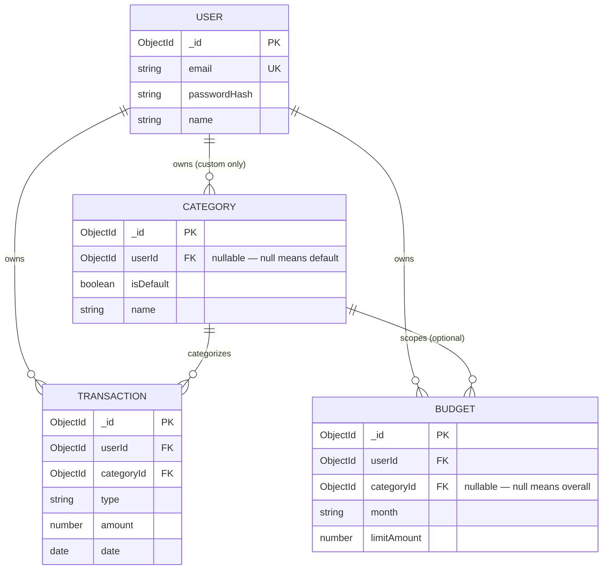

# Personal Expense Manager — Database Design

| | |
|---|---|
| **Document status** | DATABASE DESIGN BASELINE v1.0 (implementation-reconciled; formal sign-off not recorded) |
| **Date** | 2026-08-31 |
| **Builds on** | requirements-baseline-v1.0.md, architecture-baseline-v1.0.md §6 |
| **Engine** | MongoDB, accessed via Mongoose |

---

## Collection Inventory & Evaluation

**Four collections, no more:**

| Collection | Purpose |
|---|---|
| `users` | Accounts and credentials |
| `categories` | Default (system) + custom (user) transaction labels |
| `transactions` | Income/expense records — the core data of the app |
| `budgets` | Monthly spending limits, overall or per-category |

**Additional collections considered and rejected**, so this isn't a silent decision:

| Candidate | Verdict | Reasoning |
|---|---|---|
| `passwordResetTokens` | **Rejected — embed instead** | A reset token is two ephemeral scalar fields (`passwordResetToken`, `passwordResetExpires`), not a growing, independently-queried entity. Adding fields to `users` is simpler than a whole collection for something with exactly one active value per user at a time. |
| `sessions` / `refreshTokens` | **Rejected — not needed at all** | JWT auth is stateless by design (Architecture §5, Assumption #10 — single token, no rotation). No server-side session state exists to store. |
| `recurringRules` | **Deferred to Future** | Backs FR-22 (Recurring Transactions), which is out of MVP scope. Designing its schema now would mean building for a feature that isn't scheduled and may change shape before it is. |
| `exportJobs` | **Deferred to Future** | Backs FR-23 (Export). Same reasoning. |
| `notificationSettings` | **Deferred to Future** | Backs FR-25/26. When built, this is more likely a couple of fields on `users` (e.g. `remindersEnabled`) than a new collection — noted here as the extension point, not built now. |
| Audit/security log | **Rejected** | Not required by any FR or NFR. Would be speculative infrastructure. |
| Splitting `categories` into `defaultCategories` / `customCategories` | **Rejected** | Would force every "categories visible to user X" read to query two collections and merge results, and complicate the single `categoryId` reference used by `transactions`/`budgets`. One collection with a nullable `userId` + `isDefault` flag is simpler and does the same job. |
| Splitting `budgets` into `monthlyBudgets` / `categoryBudgets` | **Rejected** | Same shape, same rules (BR-05, BR-06) — a nullable `categoryId` on one collection already models "overall vs. per-category" without duplicating the schema. |

## Embedded vs. Referenced — Policy

**References only, for every relationship between the four collections.** No entity is embedded inside another. Reasoning, applied consistently:

- `transactions` and `budgets` are **unbounded/growing** collections per user (years of daily entries) — embedding them inside `users` would risk MongoDB's 16MB document ceiling and force loading a user's entire history just to read one page of it.
- `categories` must be **independently addressable** by `_id`, because `transactions` and `budgets` both reference it by `categoryId` — that reference only works cleanly if categories live in their own collection with stable top-level `_id`s, not nested inside `users`.
- Referencing also matches how the app actually queries: "transactions in this date range," "budget for this month" are all queries *against* a collection with the right index — not filters applied in application code after loading an oversized parent document.

The two extra fields on `users` for password reset (`passwordResetToken`, `passwordResetExpires`) are **not** an exception to this — they're plain scalar fields on the User document itself (like `email` or `name`), not a nested representation of a separate entity, so "embed vs. reference" doesn't really apply to them.

---

## Collection Specifications

### `users`

| Field | Type | Required | Default | Validation |
|---|---|---|---|---|
| `_id` | ObjectId | auto | — | MongoDB-generated |
| `email` | String | ✅ | — | Valid email format; lowercased + trimmed on save; **unique** |
| `passwordHash` | String | ✅ | — | Set by the Service layer after hashing — raw password length (BR-07, ≥8 chars) is validated at the input-validation layer *before* hashing, not here, since by this point it's already a fixed-length hash |
| `name` | String | ✅ | — | Trimmed, 1–100 chars |
| `passwordResetToken` | String | optional | `null` | Set only during an active reset flow (UC-05); `select: false` — excluded from normal queries |
| `passwordResetExpires` | Date | optional | `null` | Paired with the token above (BR-09) |
| `createdAt` / `updatedAt` | Date | auto | — | Mongoose `timestamps: true` |

**Indexes:** `{ email: 1 }` unique.
**Relationships:** referenced by `categories.userId`, `transactions.userId`, `budgets.userId` (one User → many of each).

```json
{
  "_id": { "$oid": "66cf0000a1b2c3d4e5f60101" },
  "email": "tien.nguyen@example.com",
  "passwordHash": "$2a$10$<bcrypt hash — never shown in API responses>",
  "name": "Nguyễn Cao Tiến",
  "createdAt": { "$date": "2026-08-01T09:00:00Z" },
  "updatedAt": { "$date": "2026-08-01T09:00:00Z" }
}
```

### `categories`

| Field | Type | Required | Default | Validation |
|---|---|---|---|---|
| `_id` | ObjectId | auto | — | |
| `userId` | ObjectId (ref `users`) | conditionally* | `null` | *Required unless `isDefault` is `true`; `null` means system default |
| `isDefault` | Boolean | ✅ | `false` | |
| `name` | String | ✅ | — | Trimmed, 1–50 chars |
| `icon` | String | optional | `null` | Free-text icon identifier |
| `color` | String | optional | `"#6B7280"` (neutral gray) | Hex color pattern |
| `createdAt` / `updatedAt` | Date | auto | — | `timestamps: true` |

**Indexes:** `{ userId: 1, name: 1 }` **unique compound** — enforces "no duplicate category name for the same user" (UC-12/E9), and also serves "one default with this name" since defaults share `userId: null`. This index also efficiently serves plain `{ userId }` lookups via left-prefix matching, so no separate single-field index is needed.
**Relationships:** many Categories → one User (optional); referenced by `transactions.categoryId`, `budgets.categoryId`.

> **New design note (not previously specified):** uniqueness is scoped **per user only** — a custom category can share a name with a default one (e.g., a user could make their own "Food & Dining"). Not worth blocking for; flagged here rather than decided silently.
> **Considered and declined:** giving categories a `defaultType` (`income`/`expense`) hint, so the UI could pre-suggest a type. Declined because `type` already lives on `transaction` (per the existing baseline) and this isn't required by any FR — noted as a clean future UI enhancement, not built now.

```json
// Default (system) category
{
  "_id": { "$oid": "66cf0000a1b2c3d4e5f60001" },
  "userId": null,
  "isDefault": true,
  "name": "Ăn uống",
  "icon": "utensils",
  "color": "#F59E0B",
  "createdAt": { "$date": "2026-01-01T00:00:00Z" },
  "updatedAt": { "$date": "2026-01-01T00:00:00Z" }
}

// Custom category
{
  "_id": { "$oid": "66cf0000a1b2c3d4e5f60007" },
  "userId": { "$oid": "66cf0000a1b2c3d4e5f60101" },
  "isDefault": false,
  "name": "Học phí",
  "icon": null,
  "color": "#6B7280",
  "createdAt": { "$date": "2026-08-05T10:00:00Z" },
  "updatedAt": { "$date": "2026-08-05T10:00:00Z" }
}
```

### `transactions`

| Field | Type | Required | Default | Validation |
|---|---|---|---|---|
| `_id` | ObjectId | auto | — | |
| `userId` | ObjectId (ref `users`) | ✅ | — | Set from the verified JWT, never from client input (BR-01) |
| `categoryId` | ObjectId (ref `categories`) | ✅ | — | Existence + ownership checked at the Service layer (Mongoose only validates it's a well-formed ObjectId, not that it exists — see Data Integrity Rules) |
| `type` | String enum | ✅ | — | `'income' \| 'expense'` only |
| `amount` | Number | ✅ | — | `> 0`; always stored positive regardless of type (see Data Integrity Rules) |
| `date` | Date | ✅ | — | The transaction's real-world date — distinct from `createdAt` |
| `note` | String | optional | `""` | Trimmed, ≤ 500 chars |
| `createdAt` / `updatedAt` | Date | auto | — | `timestamps: true` |

**Indexes:**
- `{ userId: 1, date: -1 }` — default sorted list (UC-09)
- `{ userId: 1, categoryId: 1 }` — category filter (UC-09)
- `{ userId: 1, type: 1, date: -1 }` — type filter (UC-09) and the sum-by-type-and-range query both Budget status (UC-16) and Statistics (UC-17–19) run
- Note search uses an escaped, case-insensitive literal substring condition after scoping by `userId`; no text index is required for this small personal-data workload.

**Relationships:** many Transactions → one User, many Transactions → one Category (both required).

```json
{
  "_id": { "$oid": "66cf0000a1b2c3d4e5f60201" },
  "userId": { "$oid": "66cf0000a1b2c3d4e5f60101" },
  "categoryId": { "$oid": "66cf0000a1b2c3d4e5f60001" },
  "type": "expense",
  "amount": 45000,
  "date": { "$date": "2026-08-15T00:00:00Z" },
  "note": "Cơm trưa với bạn học",
  "createdAt": { "$date": "2026-08-15T12:31:00Z" },
  "updatedAt": { "$date": "2026-08-15T12:31:00Z" }
}
```

### `budgets`

| Field | Type | Required | Default | Validation |
|---|---|---|---|---|
| `_id` | ObjectId | auto | — | |
| `userId` | ObjectId (ref `users`) | ✅ | — | |
| `month` | String | ✅ | — | Pattern `YYYY-MM` (e.g. `"2026-08"`) — avoids Date/timezone ambiguity for a month-scoped value |
| `categoryId` | ObjectId (ref `categories`) | optional | `null` | `null` = overall monthly budget (BR-05) |
| `limitAmount` | Number | ✅ | — | `> 0` |
| `createdAt` / `updatedAt` | Date | auto | — | `timestamps: true` |

**Indexes:** `{ userId: 1, month: 1, categoryId: 1 }` **unique compound** — enforces BR-05 (at most one budget per user+month+category, including at most one overall budget per month, since two "overall" budgets for the same month would both have `categoryId: null` and collide on the same key) at the database level, and doubles as the exact lookup this collection is queried by (UC-16).
**Relationships:** many Budgets → one User, many Budgets → optionally one Category.

```json
// Overall monthly budget
{
  "_id": { "$oid": "66cf0000a1b2c3d4e5f60301" },
  "userId": { "$oid": "66cf0000a1b2c3d4e5f60101" },
  "month": "2026-08",
  "categoryId": null,
  "limitAmount": 5000000,
  "createdAt": { "$date": "2026-08-01T08:00:00Z" },
  "updatedAt": { "$date": "2026-08-01T08:00:00Z" }
}

// Per-category budget
{
  "_id": { "$oid": "66cf0000a1b2c3d4e5f60302" },
  "userId": { "$oid": "66cf0000a1b2c3d4e5f60101" },
  "month": "2026-08",
  "categoryId": { "$oid": "66cf0000a1b2c3d4e5f60001" },
  "limitAmount": 1500000,
  "createdAt": { "$date": "2026-08-01T08:05:00Z" },
  "updatedAt": { "$date": "2026-08-01T08:05:00Z" }
}
```

---

## 1. ER-Style Conceptual Model



*(Also saved standalone as `database-er-diagram.mermaid`.)*

## 2. MongoDB Schema Design

Condensed schema shape for each collection — the field-by-field reasoning is in Collection Specifications above; this is the quick-reference version, in the shape it would take as a Mongoose schema definition.

```
users
  email            String    required unique lowercase trim
  passwordHash     String    required select:false
  name             String    required trim minlength:1 maxlength:100
  passwordResetToken    String   select:false
  passwordResetExpires  Date     select:false
  { timestamps: true }

categories
  userId      ObjectId  ref:'users'  default:null
  isDefault   Boolean   default:false
  name        String    required trim maxlength:50
  icon        String    default:null
  color       String    default:'#6B7280'
  { timestamps: true }
  index({ userId: 1, name: 1 }, { unique: true })

transactions
  userId      ObjectId  ref:'users'      required
  categoryId  ObjectId  ref:'categories' required
  type        String    enum:['income','expense'] required
  amount      Number    required min:0.01
  date        Date      required
  note        String    trim maxlength:500 default:''
  { timestamps: true }
  index({ userId: 1, date: -1 })
  index({ userId: 1, categoryId: 1 })
  index({ userId: 1, type: 1, date: -1 })

budgets
  userId       ObjectId  ref:'users'      required
  month        String    required match:/^\d{4}-(0[1-9]|1[0-2])$/
  categoryId   ObjectId  ref:'categories' default:null
  limitAmount  Number    required min:0.01
  { timestamps: true }
  index({ userId: 1, month: 1, categoryId: 1 }, { unique: true })
```

## 3. Index Strategy

| Collection | Index | Kind | Serves |
|---|---|---|---|
| `users` | `{ email: 1 }` | Unique | Login lookup; uniqueness (FR-01) |
| `categories` | `{ userId: 1, name: 1 }` | Unique compound | No-duplicate-name rule; "my categories" reads |
| `transactions` | `{ userId: 1, date: -1 }` | Compound | Default list, newest-first (UC-09) |
| `transactions` | `{ userId: 1, categoryId: 1 }` | Compound | Category filter (UC-09) |
| `transactions` | `{ userId: 1, type: 1, date: -1 }` | Compound | Type filter (UC-09); Budget & Statistics aggregation (UC-16–19) |
| `budgets` | `{ userId: 1, month: 1, categoryId: 1 }` | Unique compound | BR-05 enforcement; budget-status lookup (UC-16) |

**Philosophy:** every index leads with `userId` (or is scoped by it), because every query in this app is scoped to "the current user's data" (BR-01) — there's no cross-user query in the entire system. Six indexes across four collections is deliberately not more than that: each one maps to a specific, already-documented query pattern from the RTM/Use Case Model, not speculative "might need it later" indexing.

## 4. Data Integrity Rules

1. **Referential integrity is application-enforced, not database-enforced.** MongoDB has no native foreign-key constraint. Every `ObjectId` reference (`categoryId`, `userId`) is checked for *existence and ownership* at the Service layer (Architecture §4/§9); Mongoose only validates that the field is a well-formed ObjectId, not that it points to a real document. This is a standard, intentional MongoDB tradeoff — not a gap.
2. **Orphan prevention:** Category deletion is blocked at the Service layer while any Transaction references it (BR-04) — this is the system's primary defense against a dangling `categoryId`.
3. **Uniqueness is enforced at the database level** (defense in depth, not just application code) for the two rules that matter most: category-name-per-user, and one-budget-per-(month, category) (BR-05) — both via unique compound indexes, so even a Service-layer bug can't create a duplicate.
4. **Amount sign convention:** `amount` is **always stored positive**. Direction (income adds, expense subtracts, BR-02) is derived from the `type` field at aggregation time — never from a negative number. This is deliberate: it avoids the classic ambiguity of "is this expense supposed to be negative in the DB," and keeps every aggregation pipeline reading `type` explicitly rather than trusting sign.
5. **`date` vs. `createdAt`:** every aggregation (Budget status, Statistics) filters and groups by `date` (the transaction's real-world date), never `createdAt` (when the record was inserted) — a transaction logged today for last week's coffee must count toward last week.
6. **Gap, flagged rather than silently ignored:** no FR covers account deletion. If it's added later, `users` deletion needs an explicit cascade (or soft-delete/anonymize) decision for that user's `categories`/`transactions`/`budgets`, or those collections will accumulate orphaned records with a `userId` pointing nowhere. Not a problem today — worth a line in whichever future phase adds that feature.

## 5. Sample Seed Data

**Required in every environment — the 6 default categories named in README §2.3** (`ăn uống, di chuyển, hóa đơn, giải trí, lương, thưởng`), seeded once via `backend/seed.js`:

```json
[
  { "userId": null, "isDefault": true, "name": "Ăn uống",    "icon": "utensils",   "color": "#F59E0B" },
  { "userId": null, "isDefault": true, "name": "Di chuyển",  "icon": "car",        "color": "#3B82F6" },
  { "userId": null, "isDefault": true, "name": "Hóa đơn",    "icon": "receipt",    "color": "#EF4444" },
  { "userId": null, "isDefault": true, "name": "Giải trí",   "icon": "film",       "color": "#8B5CF6" },
  { "userId": null, "isDefault": true, "name": "Lương",      "icon": "briefcase",  "color": "#10B981" },
  { "userId": null, "isDefault": true, "name": "Thưởng",     "icon": "gift",       "color": "#14B8A6" }
]
```

**Optional, development/testing only — not for production:** one demo account with a few transactions and a budget, so local dev has something to look at immediately without manual data entry through the UI.

> The password hash below is a placeholder — I couldn't generate a real one in this sandbox (no network access to install `bcrypt`/`bcryptjs`, neither was already present). At seed-time, run the actual hashing function against a known password (e.g. `DemoPass123!`) rather than pasting this string.

```json
{
  "user": {
    "_id": "66cf0000a1b2c3d4e5f60101",
    "email": "demo@example.com",
    "passwordHash": "<bcrypt hash of 'DemoPass123!' — generate at seed-time>",
    "name": "Demo User"
  },
  "transactions": [
    { "userId": "66cf0000a1b2c3d4e5f60101", "categoryId": "66cf0000a1b2c3d4e5f60005", "type": "income",  "amount": 12000000, "date": "2026-08-01", "note": "Lương tháng 8" },
    { "userId": "66cf0000a1b2c3d4e5f60101", "categoryId": "66cf0000a1b2c3d4e5f60001", "type": "expense", "amount": 45000,    "date": "2026-08-15", "note": "Cơm trưa với bạn học" },
    { "userId": "66cf0000a1b2c3d4e5f60101", "categoryId": "66cf0000a1b2c3d4e5f60002", "type": "expense", "amount": 20000,    "date": "2026-08-16", "note": "Grab đi học" },
    { "userId": "66cf0000a1b2c3d4e5f60101", "categoryId": "66cf0000a1b2c3d4e5f60003", "type": "expense", "amount": 350000,   "date": "2026-08-05", "note": "Tiền điện" }
  ],
  "budget": {
    "userId": "66cf0000a1b2c3d4e5f60101",
    "month": "2026-08",
    "categoryId": null,
    "limitAmount": 5000000
  }
}
```

---

## Database Design Baseline v1.0

| | |
|---|---|
| **Status** | Baseline is implemented in Mongoose models; validate remaining integrity assumptions against the live schema before marking formally approved |
| **Scope covered** | 4 collections (`users`, `categories`, `transactions`, `budgets`); full field/type/validation spec; 6 indexes across 4 collections; ER diagram; integrity rules; required + optional seed data |
| **Collections evaluated and declined** | `passwordResetTokens`, `sessions`/`refreshTokens`, audit log, split `categories`/`budgets` — each with a stated reason, not silently omitted |
| **New decisions made at this level of detail** | Category-name uniqueness scoped per-user (not vs. defaults); no `type` field on `categories`; account-deletion cascade explicitly flagged as an open gap for whenever that feature is added |
| **Traceability** | Every field ties back to an FR/BR already in requirements-baseline-v1.0.md; every collection/relationship matches architecture-baseline-v1.0.md §6 exactly |
| **Change control** | A change here increments the version (v1.1…), same convention as the other two baselines |
| **Next phase** | API Contract and implementation already exist; keep this database baseline aligned with the deployed Mongoose schemas when they change |
