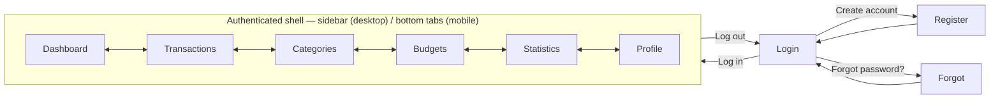

# Personal Expense Manager — UI/UX Design

| | |
|---|---|
| **Document status** | UI DESIGN BASELINE v1.0 |
| **Date** | 2026-09-01 |
| **Builds on** | api-contract-v1.0.md, database-design-baseline-v1.0.md |
| **Historical design artifact** | `expense-manager-prototype.jsx` was used during the design phase and is not included in this runnable source release; the implemented screens live under `frontend/src/`. |

---

## 1. Screen Inventory

| # | Screen | Purpose | Key states demonstrated |
|---|---|---|---|
| 1 | Login | Authenticate | default, inline validation, invalid-credentials error, loading |
| 2 | Register | Create account | validation errors, duplicate-email error (try `demo@example.com`), loading |
| 3 | Forgot Password | Request reset | validation error, sent confirmation (same message regardless of whether the email exists — BR-10) |
| 4 | Dashboard | At-a-glance financial state | populated (default); chart empty-state if a month has no expenses |
| 5 | Transactions | Browse/search/filter all transactions | populated, filtered, searched, empty (no data), empty (no matches) |
| 6/7 | Add / Edit Transaction | Create or modify a transaction | modal, not a separate page — see UI Assumptions §6.1; validation errors, loading |
| 8 | Categories | Manage default + custom categories | default (read-only, badge shown), custom (editable), delete-blocked error (try deleting "Ăn uống") |
| 9 | Budgets | Set and monitor spending limits | populated (under/near/over all represented), empty (no budgets set) |
| 10 | Statistics | Trend, breakdown, period comparison | populated; "no earlier month" state if comparing from the earliest month |
| 11 | Profile | View/edit account, log out | default, validation errors, saved confirmation |

Cross-cutting UI elements include the **EN / VI language switcher** (auth shell and authenticated top bar), **confirmation dialogs** (delete transaction/category/budget), and **toast notifications** (every create/update/delete/error).

## 2. Navigation Structure



All six destinations inside the shell are reachable directly from each other (no forced order) — this is a hub, not a wizard. Add/Edit Transaction, Add/Edit Category, and Add/Edit Budget are modals layered on top of whichever screen triggered them, not separate navigation destinations.

## 3. Component Hierarchy

```
App                                    (owns all state: auth, transactions, categories, budgets, user, toasts)
├─ Auth (unauthenticated)
│  ├─ AuthShell                        (centered card, logo, shared by all three)
│  ├─ LoginScreen
│  ├─ RegisterScreen
│  └─ ForgotPasswordScreen
└─ Authenticated shell
   ├─ Sidebar                          (desktop, ≥768px)
   ├─ BottomNav                        (mobile, <768px)
   ├─ TopBar
   ├─ DashboardScreen
   │  └─ Panel ×4                      (Budget status · Spending by category · Monthly trend · Recent transactions)
   ├─ TransactionsScreen
   │  └─ TransactionRow ×N
   ├─ CategoriesScreen
   ├─ BudgetsScreen
   ├─ StatisticsScreen
   ├─ ProfileScreen
   └─ Modals (mounted once at the root, opened from any screen)
      ├─ TransactionFormModal          (add + edit, one component)
      ├─ CategoryFormModal
      ├─ BudgetFormModal
      └─ ConfirmDialog                 (delete — reused for all three resource types)

Shared primitives (no state of their own): Button, Field, Input, Textarea, Select,
CategoryIcon, ProgressBar, EmptyState, Panel, Modal, Toast
```

Add and Edit share one form component per resource (`editing` prop present or `null`) rather than two near-duplicate components — less surface area, and the validation rules only need to live in one place per resource, matching the API contract exactly (same fields, same rules, `POST` vs `PUT`).

## 4. Design System

**Concept:** *the ledger, modernized.* A personal finance app's actual content is numbers — so the numbers get real typographic weight, and everything else stays disciplined around them. Deliberately not the purple/gradient SaaS-dashboard look.

**Color** — used to carry meaning, never as decoration:

| Token | Hex | Used for |
|---|---|---|
| Paper (background) | `#F4F6F2` | App background |
| Surface | `#FFFFFF` | Cards, modals, inputs |
| Ink (primary) | `#0E4B3F` | Primary actions, active nav, brand mark, income figures |
| Charcoal (text) | `#1D2521` | Body text, headings |
| Muted (secondary text) | `#5C6B62` | Labels, timestamps, helper text |
| Border | `#E1E5DF` | Card borders, dividers, input borders |
| Expense | `#B23A20` | Expense amounts, delete actions, error states |
| Warn (near-limit) | `#C17F17` | Budget "near limit" state |

Category colors are a coordinated secondary palette (amber/blue/brick/plum/teal) — distinguishable from each other and from the income/expense system, never reused for UI chrome.

**Typography** — two families, deliberately paired, not defaults:
- **IBM Plex Serif** (500/600) — screen titles, the Dashboard balance figure, modal titles. Used exactly where a number or heading deserves real weight.
- **IBM Plex Sans** (400/500/600) — everything else: body text, forms, buttons, table rows, chart labels. Chosen for density-legibility (transaction lists are read fast, in bulk) and for well-aligned numerals without reaching for monospace.

**Structure:**
- Left-aligned throughout — this is a working tool, not a marketing page.
- Borders over shadows for separating cards from the page; shadow reserved for things that actually float (modals, toasts).
- Moderate, consistent radius (`rounded-lg`/`rounded-xl`) — not sharp/newspaper, not bubble-rounded.
- The Dashboard balance is *not* a card — it sits directly on the page background at real display size, so it reads as the hero rather than one more tile in a grid of identical stat cards.

**Motion:** used in exactly three places, deliberately — modal open/close (scale + fade), toast entrance (slide-in), budget progress bars filling to their value on first render. Nothing hovers, lifts, or fades on scroll; restraint was spent on those three moments rather than spread thin.

**Icons:** `lucide-react`, 14–19px depending on context, one icon per category (via the same name→icon map used throughout — see `CATEGORY_META` in the artifact) so a category is recognizable by shape and color everywhere it appears (list rows, charts, budgets).

## 5. User Flows

**First login (new evaluator opening the prototype):**
Login screen → tap "Use demo account" (auto-fills credentials) → Log in → brief loading state → Dashboard.

**Add a transaction:**
Any screen → "Add transaction" → modal opens, defaults to Expense + today's date → fill amount/category/note → Save transaction → toast "Transaction added." → modal closes → the new row appears at the top of Transactions, and Dashboard totals/charts/budget bars update immediately (all derived from the same in-memory array, so nothing can drift out of sync).

**Recover a forgotten password:**
Login → "Forgot password?" → enter email → Send reset link → confirmation screen ("If an account exists for **[email]**, a reset link is on its way") regardless of whether the email is real (BR-10) → Back to log in.

**Notice a budget is at risk:**
Dashboard → Budget status panel shows a category bar in amber ("Near limit") → Budgets screen → same category card, same color, with the exact spent/limit figures → Add another expense in that category via "Add transaction" → return to Budgets → the bar has moved, possibly now red ("Over budget") — the state isn't scripted, it's computed live from whatever transactions currently exist.

## 6. Historical Prototype Assumptions (Not the Runnable Source)

The following notes document judgment calls made for the historical UI prototype. They are **not descriptions of the current runnable implementation** where the source or later amendments supersede them:

1. **Add/Edit Transaction are modals, not separate pages**, despite being listed as distinct screens. Reasoning: this is a frequent, lightweight action — modern finance apps (and the rest of this app's own CRUD screens) treat it this way rather than a full navigation. The screen inventory above still lists them as distinct, demonstrable states.
2. **Historical language assumption superseded:** the prototype used English UI chrome with Vietnamese category names/VND. The runnable source now implements EN/VI switching and persists the browser preference per FR-27/UC-25; user-created category names and transaction notes are not auto-translated.
3. **Historical prototype authentication was mocked.** The runnable source instead calls the Express API and implements JWT-based authentication; verify it against the current backend rather than using the prototype description as evidence.
4. **Historical prototype reset screen was absent.** The runnable source contains `ResetPasswordPage`; email delivery still depends on SMTP configuration, and the full reset flow must be verified using the backend and a valid token.
5. **A budget's scope (overall vs. a specific category) can't be edited after creation** — only `limitAmount` can, matching the API contract's `PUT /api/budgets/:id` exactly (month/category form the budget's identity, per BR-05).
6. **The category dropdown in the transaction form isn't filtered by income/expense type** — consistent with the database design's decision that categories are type-agnostic, not the UI cutting a corner.
7. **Default categories hide their edit/delete controls entirely** (rather than showing them disabled) — the simplest, clearest way to communicate "not available" for a prototype; a real build might prefer a disabled state with an explanatory tooltip.
8. **All data is in-memory React state.** Reloading the artifact resets it to the seed data above. This is expected for a prototype and matches "interactive artifact," not "connected to the real API."

---

## UI DESIGN BASELINE v1.0

| | |
|---|---|
| **Status** | UI design baseline with implementation reconciliation; runnable screens are in `frontend/src/`, with EN/VI switching added in the finalization pass |
| **Scope covered** | 11 screens, full CRUD interactivity, responsive shell, empty/loading/error states, confirmation dialogs, validation, design system |
| **Traceability** | Intended UI flows are cross-referenced to the API and database baselines; verify runtime edge cases through the acceptance checklist rather than assuming every design state is automatically covered |
| **Current follow-up** | Regression-check responsive layouts, EN/VI switching, and each core workflow in the running app; update this baseline if actual screens or interactions intentionally differ |
