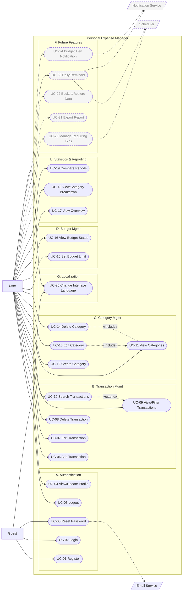
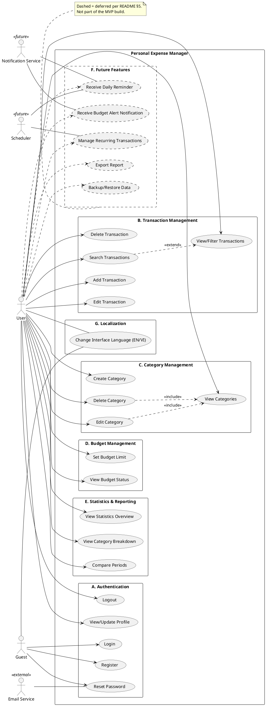

# Personal Expense Manager — Use Case Model

| | |
|---|---|
| **Document status** | Extends REQUIREMENTS BASELINE v1.0 |
| **Date** | 2026-08-31 |
| **Scope** | Full behavioral specification — Goal, Preconditions, Trigger, Main/Alternative/Exception Flow, Postconditions — for all 25 use cases identified in the baseline, plus a UML Use Case Diagram |
| **Relationship to baseline** | FR / NFR / BR full text is **not** repeated here — this document references IDs only. See `requirements-baseline-v1.0.md` for definitions. |

**Actors** (full description in baseline §3): **Guest** (unauthenticated), **User** (authenticated), **Email Service** (external, secondary). Future groups add **Scheduler** and **Notification Service** — see Group F.

**Cross-cutting exceptions** (defined once, not repeated in every use case below): every authenticated use case (all except UC-01, UC-02, UC-05) is subject to **E-AUTH-1** (missing/expired JWT → 401) and, where a specific record is targeted, **E-AUTH-2** (record belongs to another user → 403). Only exceptions unique to a use case are listed in its own entry.

---

## A. Authentication

### UC-01 — Register Account
**Actor:** Guest
**Goal:** Create an account to begin tracking personal finances.
**Preconditions:** Actor is not authenticated; supplies an email not already registered.
**Trigger:** Guest submits the Register form.
**Main Flow:**
1. Guest opens Register and enters email, password, and password confirmation.
2. System validates email format and password policy (BR-07).
3. System confirms the two password entries match.
4. System checks the email isn't already registered.
5. System hashes the password and creates a new User record.
6. System confirms success; Guest is routed to Login.

**Alternative Flow:** A1 — Guest is routed to Login rather than auto-authenticated, keeping registration and session-issuing as separate steps.
**Exception Flow:** E1 — Email already registered → 409, no account created. E2 — Password fails policy or confirmation mismatch → 400. E3 — Required field missing → 400.
**Postconditions:** A new User record exists with a hashed password; no session issued yet.
**Related FR:** FR-01

### UC-02 — Login
**Actor:** Guest
**Goal:** Authenticate to gain access to personal financial data.
**Preconditions:** Actor holds a registered email + password; not currently authenticated.
**Trigger:** Guest submits the Login form.
**Main Flow:**
1. Guest enters email and password.
2. System looks up the User by email.
3. System compares the password against the stored hash.
4. System issues a JWT (BR-08).
5. Client stores the token and routes to the Dashboard.

**Alternative Flow:** None significant — a single direct success path.
**Exception Flow:** E1 — Unknown email or wrong password → 401, generic "invalid credentials" message (doesn't reveal which field was wrong, per NFR-02).
**Postconditions:** Actor holds a valid JWT and is now the "User" actor for the session.
**Related FR:** FR-02

### UC-03 — Logout
**Actor:** User
**Goal:** End the session so the account isn't left open on a shared device.
**Preconditions:** Actor is authenticated.
**Trigger:** User selects Logout.
**Main Flow:**
1. User clicks Logout.
2. Client discards the stored JWT (ASSUMPTION #12 — client-side only).
3. Client routes to Login.

**Alternative Flow:** None.
**Exception Flow:** None meaningful — client-only operation with no server failure mode.
**Postconditions:** Client no longer holds a token; subsequent protected requests fail E-AUTH-1 until re-login.
**Related FR:** FR-03

### UC-04 — View / Update Profile
**Actor:** User
**Goal:** Review or correct account details.
**Preconditions:** Actor is authenticated.
**Trigger:** User opens Profile, or submits an edit on it.
**Main Flow:**
1. User opens Profile.
2. System returns current profile fields.
3. User edits one or more fields and submits.
4. System validates the input.
5. System persists the change and confirms.

**Alternative Flow:** A1 — User opens Profile only to view; steps 3–5 don't occur — a complete, valid use of the use case on its own.
**Exception Flow:** E1 — Invalid input (e.g. malformed email) → 400. *(Plus cross-cutting E-AUTH-1.)*
**Postconditions:** The User record reflects the updated fields, if an edit occurred.
**Related FR:** FR-04, FR-05

### UC-05 — Reset Password
**Actor:** Guest (secondary: Email Service)
**Goal:** Regain account access after forgetting the password, without a support person.
**Preconditions:** Actor is not authenticated; supplies a syntactically valid email (existence not required).
**Trigger:** Guest selects "Forgot password?" and submits an email.
**Main Flow:**
1. Guest submits their email on the Forgot Password page.
2. System generates a time-limited, single-use reset token (BR-09).
3. System hands the token to the Email Service, which delivers it to the address on file.
4. Guest opens the emailed link, arriving at Reset Password with the token pre-filled.
5. Guest submits a new password (+ confirmation).
6. System validates the token and new password, updates the password hash, and invalidates the token.
7. System confirms success; Guest is routed to Login.

**Alternative Flow:** A1 — Guest re-requests a reset link before the previous token expires → system issues a new token and invalidates the old one.
**Exception Flow:** E1 — Email doesn't match any account → generic success message returned but no email sent (BR-10, prevents account enumeration). E2 — Token expired, invalid, or already used → 400/401. E3 — New password fails policy → 400.
**Postconditions:** On success, the password hash is updated and the token is invalidated.
**Related FR:** FR-06, FR-07

---

## B. Transaction Management

### UC-06 — Add Transaction
**Actor:** User
**Goal:** Record a new income or expense so it's reflected in history, budgets, and statistics.
**Preconditions:** Actor is authenticated; the chosen category already exists (default or custom).
**Trigger:** User submits the Add Transaction form.
**Main Flow:**
1. User opens Add Transaction.
2. User enters amount, date, category, type (income/expense), optional note.
3. System validates required fields and that the category exists and belongs to the user (or is default).
4. System persists the transaction, linked to the user (BR-01).
5. UI adds it to the list and refreshes affected budget/statistics widgets.

**Alternative Flow:** A1 — User records an income transaction; same flow, `type` differs, excluded from budget totals (BR-02).
**Exception Flow:** E1 — Invalid amount/date → 400. E2 — Category doesn't exist or isn't the user's → 400/404.
**Postconditions:** A new Transaction record exists, owned by the User; any covering Budget recalculates on next read.
**Related FR:** FR-08

### UC-07 — Edit Transaction
**Actor:** User
**Goal:** Correct a previously entered transaction.
**Preconditions:** Actor is authenticated; the target transaction belongs to the actor.
**Trigger:** User selects a transaction and submits changes.
**Main Flow:**
1. User selects a transaction and opens it for editing.
2. User modifies one or more fields.
3. System validates ownership and the new values.
4. System persists the change; UI reflects it and refreshes dependent widgets.

**Alternative Flow:** A1 — User changes only the note, leaving amount/date/category unchanged.
**Exception Flow:** E1 — Not the user's transaction → E-AUTH-2. E2 — Invalid new values → 400. E3 — Transaction ID doesn't exist → 404.
**Postconditions:** The Transaction reflects the new values; dependent views recalculate on next read.
**Related FR:** FR-09

### UC-08 — Delete Transaction
**Actor:** User
**Goal:** Remove a transaction entered by mistake or no longer relevant.
**Preconditions:** Actor is authenticated; the target transaction belongs to the actor.
**Trigger:** User confirms deletion of a selected transaction.
**Main Flow:**
1. User selects a transaction and chooses Delete.
2. System prompts for confirmation.
3. User confirms.
4. System validates ownership and removes the record.
5. UI removes it; dependent widgets recalculate.

**Alternative Flow:** A1 — User cancels the confirmation prompt; no change occurs (a valid path, not an exception).
**Exception Flow:** E1 — Not the user's transaction → E-AUTH-2. E2 — Transaction ID doesn't exist (already deleted) → 404.
**Postconditions:** The Transaction record no longer exists.
**Related FR:** FR-10

### UC-09 — View / Filter Transactions
**Actor:** User
**Goal:** Review past transactions, narrowed to a relevant subset.
**Preconditions:** Actor is authenticated.
**Trigger:** User opens the Transactions list, or changes a filter.
**Main Flow:**
1. User opens Transactions.
2. System returns the user's transactions, most recent first, unfiltered by default.
3. User applies a filter — date range, category, and/or type.
4. System returns the matching subset; UI re-renders.

**Alternative Flow:** A1 — Only one filter dimension applied. A2 — All three combined. A3 — Filters cleared to return to the full list.
**Exception Flow:** E1 — Invalid filter parameters (e.g. malformed date range) → 400. E2 — No matches → empty list, not an error.
**Postconditions:** None persisted — read-only.
**Related FR:** FR-11

### UC-10 — Search Transactions
**Actor:** User
**Goal:** Find a specific transaction by remembered note text, faster than scrolling.
**Preconditions:** Actor is authenticated.
**Trigger:** User types into the search field.
**Main Flow:**
1. User enters a keyword on the Transactions page.
2. System matches it against transaction notes, case-insensitive.
3. System returns matches; UI re-renders.

**Alternative Flow:** A1 — Search combined with an active date/category/type filter, narrowing further. *(Extends UC-09 — see diagram.)*
**Exception Flow:** E1 — No matches → empty list, not an error.
**Postconditions:** None persisted — read-only.
**Related FR:** FR-12

---

## C. Category Management

### UC-11 — View Categories
**Actor:** User
**Goal:** See available categories before tagging a transaction or reviewing spending.
**Preconditions:** Actor is authenticated.
**Trigger:** User opens Categories, or the category dropdown on the transaction form.
**Main Flow:**
1. User opens Categories.
2. System returns default categories + the user's custom categories.
3. UI renders the combined list.

**Alternative Flow:** None significant.
**Exception Flow:** None beyond the cross-cutting exceptions.
**Postconditions:** None persisted — read-only.
**Related FR:** FR-13

### UC-12 — Create Category
**Actor:** User
**Goal:** Add a spending/income label not covered by the defaults.
**Preconditions:** Actor is authenticated.
**Trigger:** User submits the "New category" form.
**Main Flow:**
1. User enters a category name (optionally icon/color).
2. System validates it's non-empty and not a duplicate for this user.
3. System persists it, linked to the user.
4. UI adds it, immediately available for new transactions.

**Alternative Flow:** None significant.
**Exception Flow:** E1 — Duplicate name for this user → 409. E2 — Empty/invalid name → 400.
**Postconditions:** A new Category record exists, owned by the User.
**Related FR:** FR-14

### UC-13 — Edit Category
**Actor:** User
**Goal:** Rename or restyle a custom category without losing its transaction history.
**Preconditions:** Actor is authenticated; the target is a custom category the actor owns, not a default (BR-03).
**Trigger:** User submits changes on an existing custom category.
**Main Flow:**
1. User selects a custom category and edits its name/attributes.
2. System validates ownership and that it isn't a default category.
3. System persists the change; existing transactions keep their link, so history is unaffected.

**Alternative Flow:** None significant. *(Includes UC-11 — user typically selects from the category list first; see diagram.)*
**Exception Flow:** E1 — Target is a default category → 403 (BR-03). E2 — Belongs to another user → E-AUTH-2. E3 — New name is a duplicate → 409.
**Postconditions:** The Category record reflects the new values.
**Related FR:** FR-15

### UC-14 — Delete Category
**Actor:** User
**Goal:** Remove a custom category no longer needed.
**Preconditions:** Actor is authenticated; the target is a custom category the actor owns.
**Trigger:** User confirms deletion of a custom category.
**Main Flow:**
1. User selects a custom category and chooses Delete.
2. System checks whether any transaction still references it (BR-04).
3. Finding none, system deletes it; UI removes it from the list.

**Alternative Flow:** None significant on the success path. *(Includes UC-11 — see diagram.)*
**Exception Flow:** E1 — Target is a default category → 403 (BR-03). E2 — ≥1 transaction still references it → 409, blocked; UI suggests reassigning or deleting those transactions first (BR-04). E3 — Belongs to another user → E-AUTH-2.
**Postconditions:** On success, the Category no longer exists. On E2, no change occurs.
**Related FR:** FR-16

---

## D. Budget Management

### UC-15 — Set Budget Limit
**Actor:** User
**Goal:** Cap planned spending for a month, overall or per category — the app's core budgeting purpose.
**Preconditions:** Actor is authenticated.
**Trigger:** User submits the Budget Settings form.
**Main Flow:**
1. User opens Budget Settings.
2. User enters a limit amount, a month, and optionally a category.
3. System validates the amount is positive and no budget already exists for this (month, category) pair (BR-05).
4. System persists the budget; UI confirms and reflects it on the Dashboard.

**Alternative Flow:** A1 — Overall monthly budget with no category selected. A2 — Several per-category budgets set for the same month, one at a time.
**Exception Flow:** E1 — Budget already exists for this (month, category) → 409 (BR-05). E2 — Non-positive limit → 400.
**Postconditions:** A Budget record exists for the specified (month, category) with the given limit.
**Related FR:** FR-17

### UC-16 — View Budget Status
**Actor:** User
**Goal:** See at a glance whether spending is on track before it goes over.
**Preconditions:** Actor is authenticated.
**Trigger:** User opens the Dashboard or Budget page.
**Main Flow:**
1. User opens the Dashboard.
2. System sums the user's *expense* transactions for the relevant month(+category) — income excluded (BR-02).
3. System compares the total to the limit and derives a state: under / near (≥80%) / over (≥100%) (BR-06).
4. UI renders the corresponding visual indicator.

**Alternative Flow:** A1 — No budget exists yet for the current month → UI shows a "no budget set" prompt instead of a status bar (not an error).
**Exception Flow:** None beyond the cross-cutting exceptions — a read/aggregate operation with no user-input failure mode.
**Postconditions:** None persisted — read-only.
**Related FR:** FR-18

---

## E. Statistics and Reporting

### UC-17 — View Statistics Overview
**Actor:** User
**Goal:** Understand the overall income vs. expense trend over a chosen period.
**Preconditions:** Actor is authenticated.
**Trigger:** User opens Statistics, or changes the selected granularity.
**Main Flow:**
1. User opens Statistics.
2. User selects a granularity: day, week, month, or year.
3. System aggregates income and expense totals for that granularity.
4. UI renders a chart of the results.

**Alternative Flow:** A1 — User switches granularity repeatedly to compare shapes without leaving the page.
**Exception Flow:** E1 — No transactions in range → chart renders an empty/zero state, not an error.
**Postconditions:** None persisted — read-only.
**Related FR:** FR-19

### UC-18 — View Category Breakdown
**Actor:** User
**Goal:** See which categories consume the most spending.
**Preconditions:** Actor is authenticated.
**Trigger:** User opens the category-breakdown view of Statistics.
**Main Flow:**
1. User opens the category view.
2. System aggregates expense totals grouped by category for the selected period.
3. UI renders a pie/donut chart, one slice per category.

**Alternative Flow:** A1 — User narrows the period before viewing the breakdown.
**Exception Flow:** E1 — No expenses in the period → empty state, not an error.
**Postconditions:** None persisted — read-only.
**Related FR:** FR-20

### UC-19 — Compare Periods
**Actor:** User
**Goal:** Judge whether spending/income is improving or worsening relative to another period.
**Preconditions:** Actor is authenticated.
**Trigger:** User selects two periods to compare.
**Main Flow:**
1. User selects Period A and Period B.
2. System aggregates totals for each period independently.
3. System computes the difference and percentage change.
4. UI renders the two periods side by side with the delta highlighted.

**Alternative Flow:** A1 — User compares two custom, non-adjacent date ranges rather than calendar-standard periods.
**Exception Flow:** E1 — One or both periods have no data → that side renders as zero; comparison still computes.
**Postconditions:** None persisted — read-only.
**Related FR:** FR-21

---

## F. Future Features

*Not scheduled for MVP build. Flows below are preliminary — they'll be firmed up when each feature enters active development, per README §5.*

### UC-20 — Manage Recurring Transactions *(Future)*
**Actor:** User (secondary: Scheduler)
**Goal:** Avoid manually re-entering the same transaction (rent, salary) every period.
**Preconditions:** Actor is authenticated.
**Trigger:** User sets up or edits a recurring rule.
**Main Flow (preliminary):** 1. User defines a template transaction + recurrence rule. 2. System stores the rule. 3. Scheduler creates a new Transaction from the rule each time it's due.
**Alternative Flow (preliminary):** User pauses or ends a recurring rule early.
**Exception Flow (preliminary):** Recurrence rule conflicts with an existing one; invalid pattern.
**Postconditions:** A RecurringRule record exists; Transactions are generated automatically going forward.
**Related FR:** FR-22

### UC-21 — Export Report *(Future)*
**Actor:** User
**Goal:** Get transaction data out of the app for external use (taxes, spreadsheets).
**Preconditions:** Actor is authenticated; ≥1 transaction exists to export.
**Trigger:** User selects Export and a format.
**Main Flow (preliminary):** 1. User selects a date range and format (Excel/PDF). 2. System generates the file. 3. System returns it for download.
**Alternative Flow (preliminary):** User exports a filtered subset instead of all transactions.
**Exception Flow (preliminary):** No data in range; file generation failure.
**Postconditions:** A downloadable file is produced; no data changes.
**Related FR:** FR-23

### UC-22 — Backup / Restore Data *(Future)*
**Actor:** User
**Goal:** Protect against accidental data loss and recover from it.
**Preconditions:** Actor is authenticated.
**Trigger:** User requests a backup, or initiates a restore.
**Main Flow (preliminary):** 1. User requests an export of all their data. 2. System produces a backup file. 3. On restore, user uploads that file and the system replaces or merges the data.
**Alternative Flow (preliminary):** Restore merges with existing data instead of replacing it.
**Exception Flow (preliminary):** Corrupted/invalid backup file; restore would overwrite newer data.
**Postconditions:** On backup, a file exists outside the system. On restore, the user's data matches the backup.
**Related FR:** FR-24
*(Distinct from NFR-08, the system-level backup already resolved for MVP via Assumption #3 — this is a user-facing feature, not yet built.)*

### UC-23 — Receive Daily Reminder *(Future)*
**Actor:** User (secondary: Scheduler, Notification Service)
**Goal:** Be nudged to log the day's spending before it's forgotten.
**Preconditions:** Actor has opted in to reminders.
**Trigger:** A scheduled time of day is reached for a given user.
**Main Flow (preliminary):** 1. Scheduler checks which opted-in users haven't logged a transaction today. 2. System sends a notification via the Notification Service.
**Alternative Flow (preliminary):** User already logged a transaction today, so no reminder is sent.
**Exception Flow (preliminary):** Notification delivery failure.
**Postconditions:** A notification has been dispatched (or suppressed).
**Related FR:** FR-25

### UC-24 — Receive Budget Alert Notification *(Future)*
**Actor:** User (secondary: Notification Service)
**Goal:** Be actively alerted the moment a budget is exceeded, not just when checking the Dashboard.
**Preconditions:** A budget exists for the relevant month/category.
**Trigger:** A transaction pushes cumulative spending past the "near" or "over" threshold (BR-06).
**Main Flow (preliminary):** 1. System detects the threshold crossing after a transaction is saved. 2. System sends a push/email notification via the Notification Service.
**Alternative Flow (preliminary):** User has disabled notifications for this budget; none sent.
**Exception Flow (preliminary):** Delivery failure; needs a "already notified" guard to avoid duplicate alerts for the same crossing.
**Postconditions:** A notification has been dispatched.
**Related FR:** FR-26
*(Distinct from UC-16, the in-app indicator already in MVP — this is the push/scheduled variant.)*

---

### UC-25 — Change Interface Language
**Actor:** Guest or User
**Goal:** Use the application UI in English or Vietnamese.
**Preconditions:** The app is available in a browser; authentication is not required.
**Trigger:** Actor selects `EN` or `VI` in the language switcher.
**Main Flow:** 1. Actor selects a language. 2. The UI updates translated labels, common messages, date/currency formatting and chart labels. 3. The browser stores the preference in `localStorage` under `pem-language`. 4. After a page refresh in the same browser, the UI restores the saved preference.
**Alternative Flow:** If browser storage is unavailable, the language remains selected for the current in-memory session where possible; the app falls back to English when no saved preference exists.
**Exception Flow:** Unsupported locale values are normalized to English. The language switch must not mutate application records or user-entered strings.
**Postconditions:** The UI uses the selected language; API contracts, VND amounts, custom category names, transaction notes, and database records remain unchanged.
**Related FR:** FR-27 · **Test reference:** TC-22

---

## UML Use Case Diagram

One complete model, all 25 use cases. Groups A–E and G (Localization) are solid (MVP); Group F and its actors (Scheduler, Notification Service) are dashed (Future). Two genuine `«include»` relationships (UC-13, UC-14 → UC-11 — both start from the category list) and one `«extend»` (UC-10 extends UC-09 — search is an optional addition to viewing the list) are modeled explicitly rather than invented filler.

### Mermaid (renders inline — also saved standalone as `use-case-diagram.mermaid`)

### PlantUML (paste into the PlantUML online server or an IDE plugin)

**Note on rendering:** the PlantUML `#line.dashed` styling wasn't independently render-tested — if your PlantUML version rejects it, drop those style tags; the actors, use cases, packages, and relationships underneath are the part that matters and are standard syntax. The Mermaid version is the one guaranteed to render inline here and in most markdown viewers that support Mermaid fences.

If the combined diagram is too dense for a slide or report page, I can split it into one diagram per group (A–F) on request — six small, readable diagrams instead of one large one.
